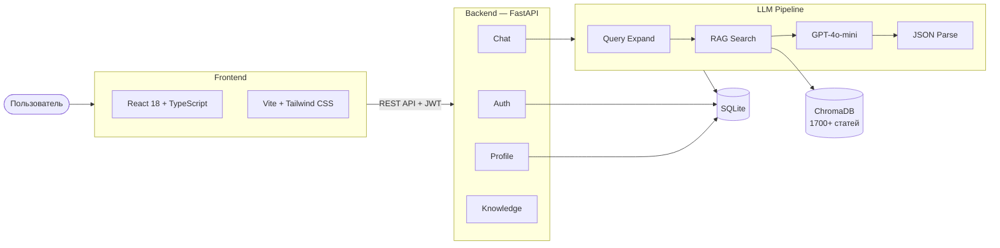
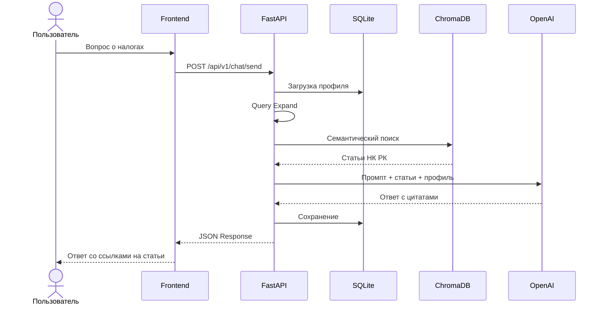

# Salyq AI — Архитектура системы

## Общая схема

## Поток обработки запроса

## Стек технологий

| Слой | Технологии |
|------|-----------|
| **Frontend** | React 18, TypeScript, Vite, Tailwind CSS, Framer Motion |
| **Backend** | FastAPI, Python 3.13, Uvicorn |
| **AI / ML** | OpenAI GPT-4o-mini, ChromaDB, SentenceTransformers (multilingual-e5-large) |
| **Auth** | JWT (PyJWT), bcrypt |
| **Data** | SQLite, 1700+ статей Налогового кодекса РК |
| **DevOps** | Docker, Docker Compose, Nginx |
